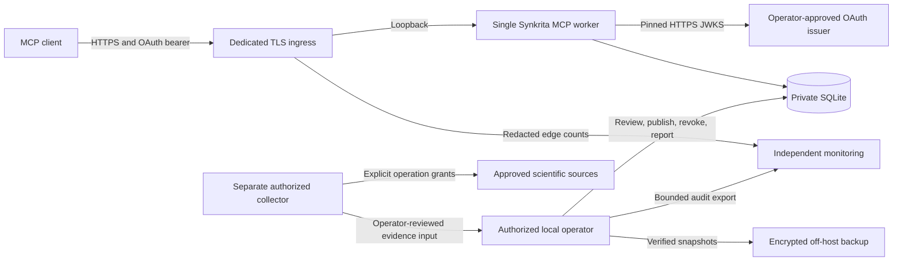

# Reference architecture and operating requirements

The issuer authenticates users. The hosted worker verifies RS256 access tokens against pinned issuer, audience, JWKS and client policy. It checks current account authorization and private ownership in SQLite. The three hosted tools accept exact receipt, decision or investigation IDs. Publication requires an operator-approved evidence projection. Decision activation requires a scoped reviewer signature, and reads recheck current policy, dependencies and applicability. Source response content supplies no permission to invoke tools or publish evidence.

The operator collector has a separate outbound boundary. Its configured source views, operations and evidence limits are distinct from the hosted worker's token and read authorization. The trusted-local stdio interface also runs separately. Use a single hosted worker with a private local database and treat audit and usage data as restricted.

## Mandatory controls for hosted operators

- **Release and access.** Verify the exact archive, hashes and authorized signature with an independently pinned key for controlled deployments. Keep ingress closed during preparation. Obtain separate approval for staging HTTPS and public access. Start with closed enrollment.
- **Identity and transport.** Use an exact HTTPS resource, approved issuer and JWKS, explicit client registrations and callback URIs, and short-lived RS256 user access tokens with `research:access`. Honor the configured issuer and host exactly. Use the dedicated non-root worker on loopback behind restricted TLS ingress. Keep forwarding identity headers outside the worker's trust boundary. Enforce destination-limited egress and default-deny incoming network policy in both IP families.
- **State and authority.** Use private service-owned state and encrypted, bounded storage. Keep production tokens, private notes and reviewer signing keys out of the repository and monitoring streams. Give administrative commands to named operators with scoped OS permissions. Approve source rights, retention, projection and reviews independently.
- **Operations and recovery.** Run the existing external probe and restricted audit shipping. Test alert receipt, effective limits, off-host encrypted recovery, replay of revocations and usage coverage. Review concurrent SQLite behavior on the target and apply the approved audit and usage retention plan before adding researchers.

The supplied profile uses systemd and NGINX on a dedicated VM. A fork may adapt the profile to its own environment after verifying equivalent controls and local approval. See the [configuration quick start](SELF_HOSTING.md) and [operator package acceptance requirements](SELF_HOSTING.md#operator-package-and-acceptance).
